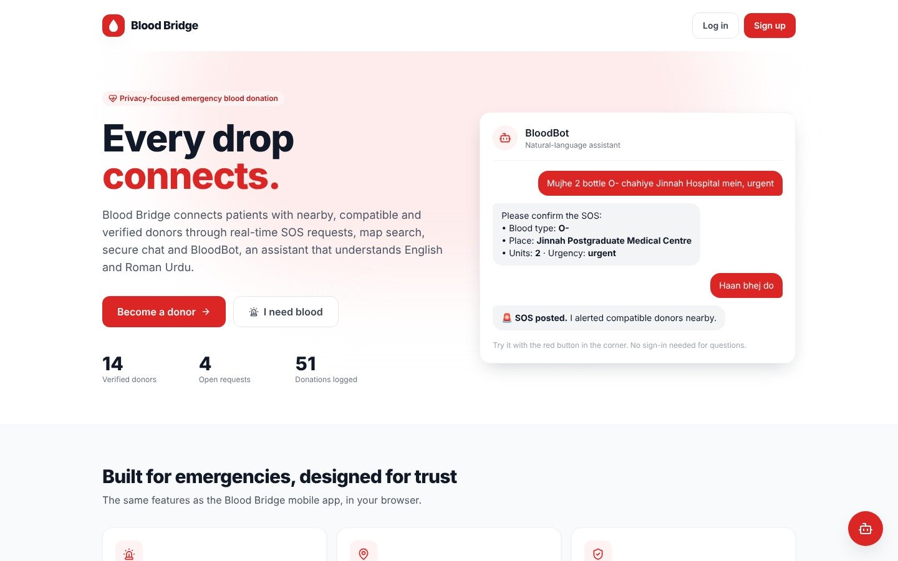
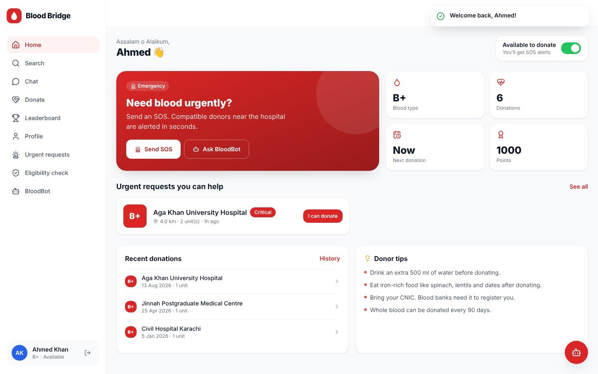
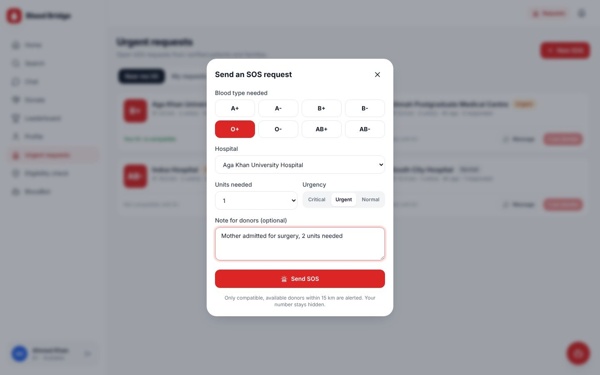
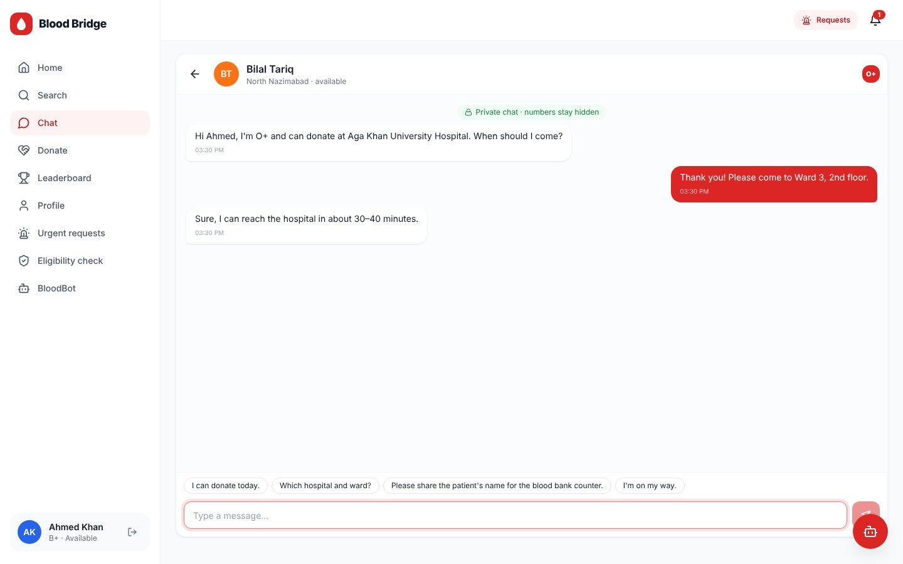
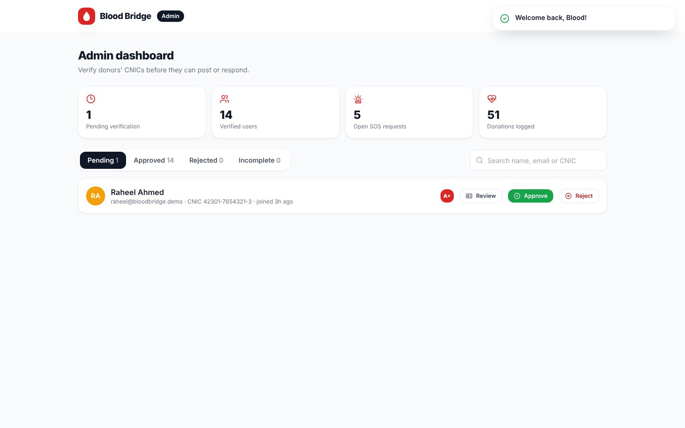

# Blood Bridge — Web App

A web version of **Blood Bridge**, a blood-donation platform for Karachi that connects people who need blood with verified donors nearby. It's built from the React Native/Firebase mobile app I worked on as a team contributor ([mobile app + BloodBot](https://github.com/hfsachndio/blood-bridge-app)), and it includes **BloodBot**, the NLP assistant (English and Roman Urdu).

**Live demo:** https://blood-bridge-opal.vercel.app

| Demo account | Email | Password |
|---|---|---|
| Donor | `ahmed@bloodbridge.demo` | `Demo#1234` |
| Admin | `admin@bloodbridge.demo` | `Admin#1234` |

You can also sign up as a new user (a real Supabase Auth account). The demo approves your CNIC automatically after a few seconds, which mimics the admin review. All data is stored in Supabase Postgres and updates live across browsers.


## Screenshots

| | |
|---|---|
|  Landing |  Donor home |
|  Send an SOS |  Urgent requests |
|  Find donors |  Private chat (Realtime) |
|  BloodBot |  Leaderboard |
|  Admin CNIC review |  Profile |

## Features

- **Auth and verification:** sign up, log in, password reset, and a profile builder (date of birth, weight, area, blood type, CNIC with auto-formatting, CNIC photo). After that the account goes to pending review, then admin approval.
- **SOS requests:** send an urgent request for a hospital. Compatible, available donors within 15 km are notified. Donors can respond, and the requester can close the request.
- **Search:** an OpenStreetMap map with filters for blood type (compatibility-aware), radius and area. It covers donors, donation offers and the nearest blood banks.
- **Chat:** one-to-one messaging with unread badges.
- **Donate:** post an offer and pick its location on the map.
- **Leaderboard and awards:** 100 points per offer and 150 per logged donation, plus milestone badges.
- **Donation history:** log a donation and get a printable certificate.
- **Eligibility check:** the same rules as the mobile app (age, weight, 90-day gap, tattoo, illness and so on).
- **Admin dashboard:** review CNIC submissions, then approve or reject them.
- **Pick up where you left off:** each account's last page is remembered, and signing in opens it again (admins return to the admin dashboard).
- **Responsive design:** a sidebar on desktop, bottom tabs on mobile.

## AI in Blood Bridge

Three different kinds of AI, all running in the browser with no API keys or paid services:

| | Type | What it does |
|---|---|---|
| **BloodBot** | NLP (TF-IDF intent classifier + entity extraction) | Understands English and Roman Urdu requests; 96.6% held-out intent accuracy |
| **Donor-response model** | Neural network (10→24→12→1 MLP, trained in [`ml/`](ml/)) | Predicts which donors will answer an SOS within an hour; SOS alerts go to the most likely donors first and search can sort by it. Ranks donors far better than nearest-first (NDCG@3 0.78 vs 0.68) |
| **CNIC reader** | Computer vision (image-quality checks + Tesseract LSTM OCR in WebAssembly) | Reads the uploaded CNIC photo, flags blurry or dark images, extracts the number and birth date, checks the number matches what was typed and shows the result to the admin |

Training data, evaluation, model cards and parity tests are in [`ml/`](ml/README.md) and `src/lib/ai/__tests__`.

## NLP: BloodBot (new in the web version)

BloodBot understands **English and Roman Urdu** (for example "meri ammi ko 2 bottle AB- chahiye indus mein, critical"). It runs entirely in the browser, with no API key and no data leaving the device.

| Stage | What it does | File |
|---|---|---|
| Normalisation | Maps Roman Urdu to English (khoon → blood, chahiye → need), lowercases, removes stop-words, applies a light stemmer | `src/lib/nlp/text.ts` |
| Intent classification | TF-IDF over unigrams and bigrams, cosine k-NN against 250+ labelled phrases (29 intents), with a confidence threshold and an out-of-domain fallback | `src/lib/nlp/classifier.ts` |
| Named-entity recognition | Blood types in any spelling, typo-tolerant Karachi areas and hospitals (Levenshtein), units (including Urdu numbers), age, weight, days since, urgency | `src/lib/nlp/entities.ts` |
| Dialogue manager | Slot filling for multi-turn tasks (SOS: blood type → hospital → units → urgency → confirm), follow-ups, and actions on real app data | `src/lib/nlp/bot.ts` |

Held-out intent accuracy is **96.6%**; see `src/lib/nlp/__tests__`. Switch on "Show NLP details" on the BloodBot page to see each message's intent, confidence and entities.

## Tech

**Frontend:** Vite, React 18, TypeScript (strict), Tailwind CSS, React Router, React-Leaflet (OpenStreetMap), lucide-react, Vitest.

**Backend (full stack, Supabase):**

- **Supabase Auth** for email/password sessions. Sign-up goes through a serverless function that creates a confirmed user with the Admin API.
- **Supabase Postgres** holds `profiles`, `profile_private` (CNIC, phone, email), `requests`, `donations`, `records`, `chats`, `messages` and `notifications`. **Row Level Security** is on for every table: members can read the community data, but only you (or an admin) can read your private details, and chats/messages are visible to participants only.
- **Vercel serverless API** (`api/index.js`, Node + `pg`, service role). Clients never write to the tables directly. Every write goes to `/api/sync`, which checks ownership: you can only edit your own profile, requests and offers; you can't approve yourself or change your role; you can only add *yourself* as a responder; and you can only post messages in your own chats. Admins can approve or reject CNICs.
- **Supabase Realtime** (`postgres_changes`, filtered by RLS) pushes new SOS alerts, chat messages and notifications to the browser instantly, with polling as a fallback.
- **Schema + seed as code:** `scripts/setup-db.ts` runs in the Vercel build. It creates the tables, policies and realtime publication idempotently, then seeds the demo community once (demo auth users included).
- The browser keeps a local cache of the data, so the UI and BloodBot work instantly. Changes sync in the background (optimistic updates).

```bash
npm install
# local Postgres (no Supabase needed): a stand-in auth schema and dev login are used
POSTGRES_URL=postgresql://postgres@localhost:5432/bloodbridge npm run setup-db
npm run dev      # API on :8787 + Vite on :5173
npm test         # NLP + dialogue tests (offline store)
npm run build
```

On Vercel, the Supabase integration provides `SUPABASE_URL`, `SUPABASE_SERVICE_ROLE_KEY`, `VITE_SUPABASE_URL`, `VITE_SUPABASE_ANON_KEY` and `POSTGRES_URL(_NON_POOLING)`.

## Credits

The original **Blood Bridge** mobile app (React Native + Firebase) was built as a team project; I was one of the contributors. This web app is my own adaptation of that project's flows, data model and eligibility rules, and the NLP assistant is my addition.
