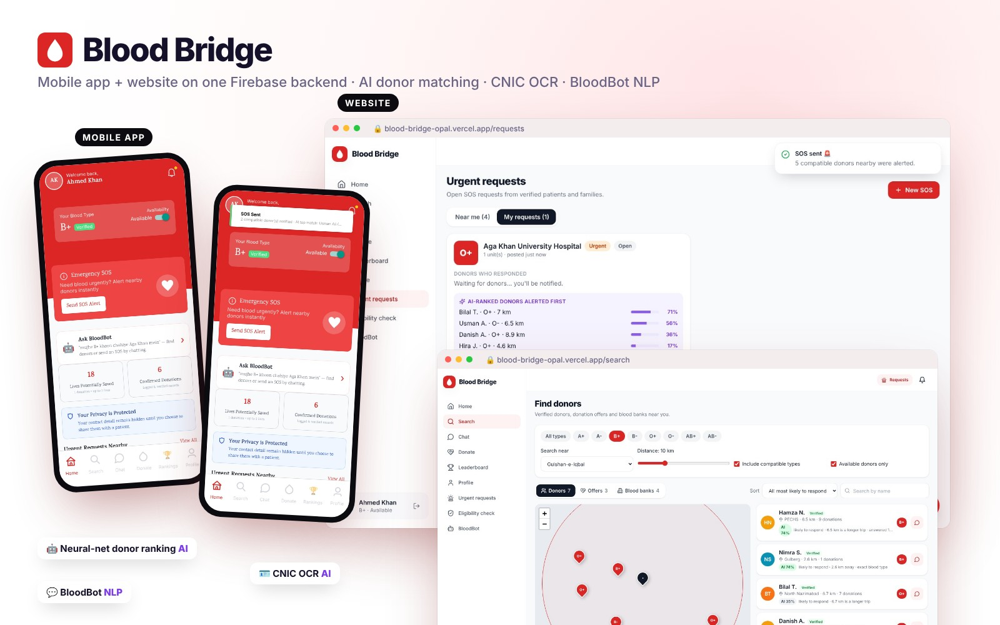
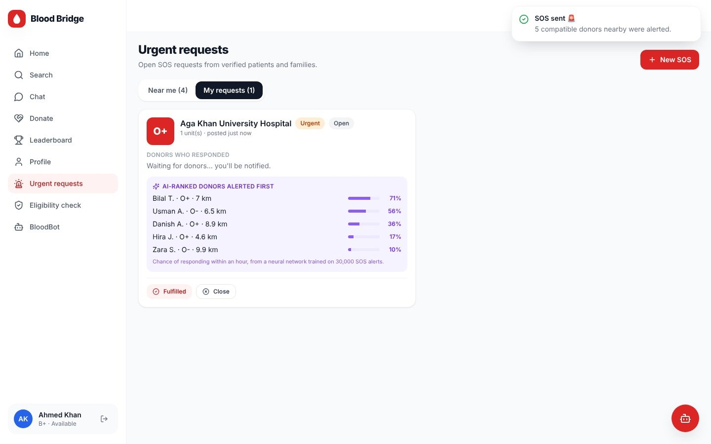
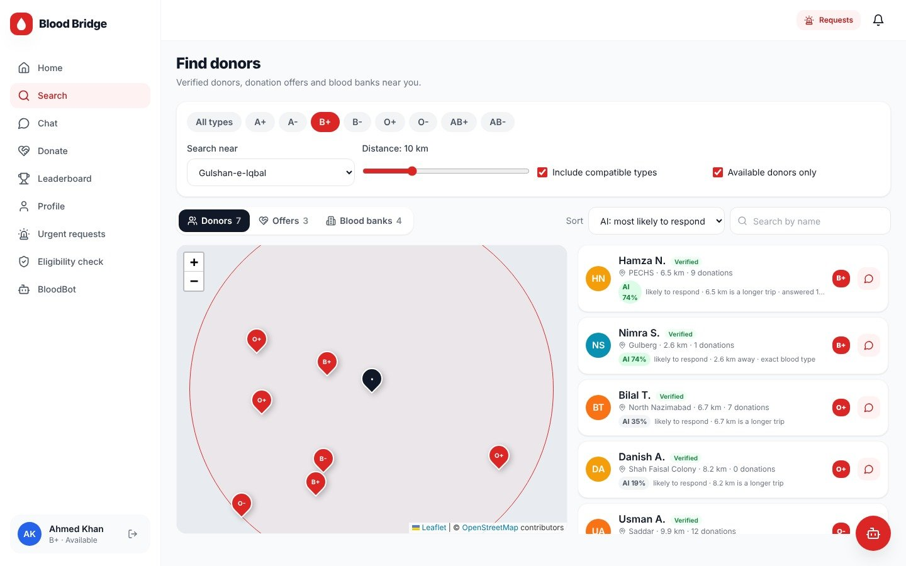
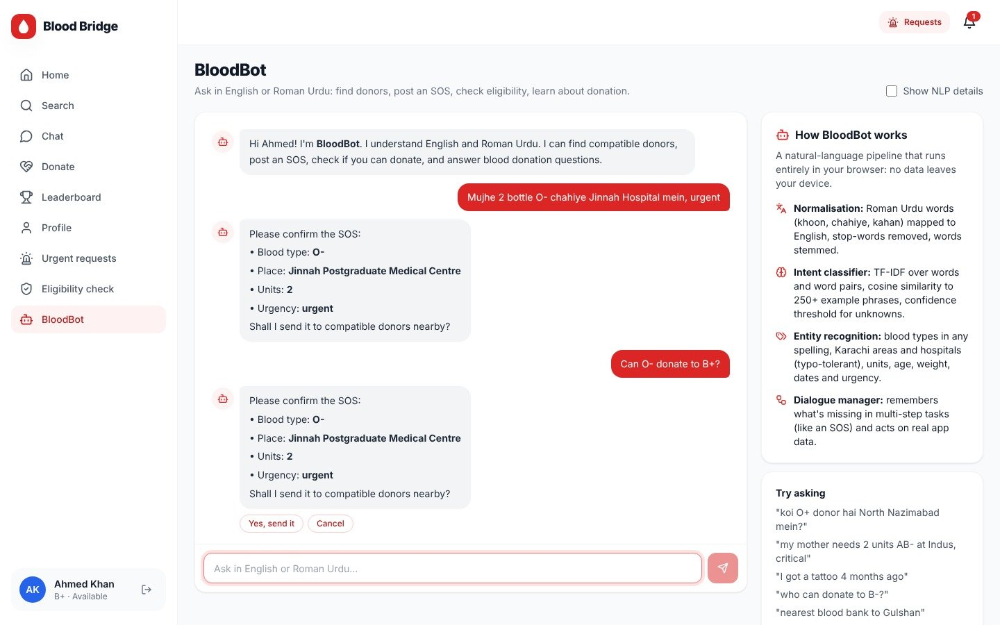
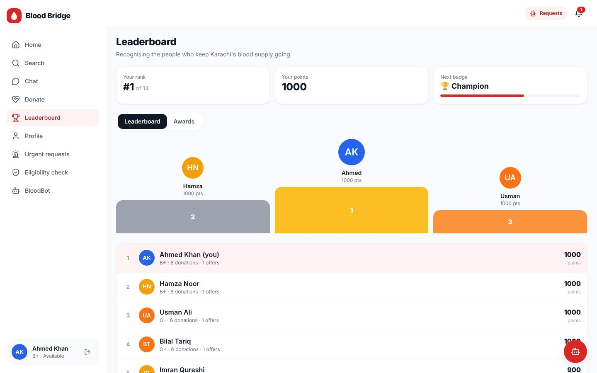
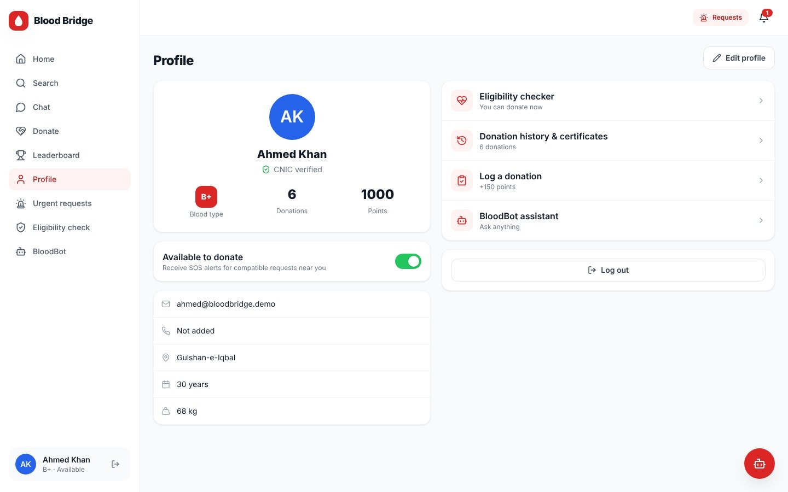

# Blood Bridge — Web App

A web version of **Blood Bridge**, a blood-donation platform for Karachi that connects people who need blood with verified donors nearby. It's built from the React Native/Firebase mobile app I worked on as a team contributor ([mobile app + BloodBot](https://github.com/hfsachndio/blood-bridge-app)), and it includes **BloodBot**, the NLP assistant (English and Roman Urdu).

**Live site:** https://blood-bridge-opal.vercel.app · **Mobile app (web build):** https://blood-bridge-app-nine.vercel.app

**Videos:** [website](docs/media/BloodBridgeWeb-demo.mp4) · [app + website together](docs/media/BloodBridge-app-and-web.mp4)



Sign up with your own email (a real Firebase Auth account). A well-formed CNIC is verified automatically after a few seconds, and the admin can also approve or reject it. **The website and the mobile app share one Firebase project** (same logins, same Firestore data), so an SOS sent from the app shows up here live and vice versa.


## Screenshots

| | |
|---|---|
|  Landing |  Donor home |
|  Send an SOS |  Urgent requests |
|  Find donors |  Private chat (Firestore, live) |
|  BloodBot |  Leaderboard |
|  Admin CNIC review |  Profile |

## Features

- **Auth and verification:** sign up, log in, password reset, and a profile builder (date of birth, weight, area, blood type, CNIC with auto-formatting, CNIC photo). After that the account goes to pending review, then admin approval.
- **SOS requests:** send an urgent request for a hospital. Compatible, available donors within 15 km are notified. Donors can respond, and the requester can close the request.
- **Search:** an OpenStreetMap map with filters for blood type (compatibility-aware), radius and area. It covers donors, donation offers and the nearest blood banks.
- **Chat:** one-to-one messaging with unread badges.
- **Donate:** post an offer and pick its location on the map.
- **Leaderboard and awards:** 100 points per offer and 150 per logged donation, plus milestone badges.
- **Donation history:** log a donation and get a printable certificate.
- **Eligibility check:** the same rules as the mobile app (age, weight, 90-day gap, tattoo, illness and so on).
- **Admin dashboard:** review CNIC submissions, then approve or reject them.
- **Pick up where you left off:** each account's last page is remembered, and signing in opens it again (admins return to the admin dashboard).
- **Responsive design:** a sidebar on desktop, bottom tabs on mobile.

## AI in Blood Bridge

Three different kinds of AI, all running in the browser with no API keys or paid services:

| | Type | What it does |
|---|---|---|
| **BloodBot** | NLP (TF-IDF intent classifier + entity extraction) | Understands English and Roman Urdu requests; 96.6% held-out intent accuracy |
| **Donor-response model** | Neural network (10→24→12→1 MLP, trained in [`ml/`](ml/)) | Predicts which donors will answer an SOS within an hour; SOS alerts go to the most likely donors first and search can sort by it. Ranks donors far better than nearest-first (NDCG@3 0.78 vs 0.68) |
| **CNIC reader** | Computer vision (image-quality checks + Tesseract LSTM OCR in WebAssembly) | Reads the uploaded CNIC photo, flags blurry or dark images, extracts the number and birth date, checks the number matches what was typed and shows the result to the admin |

Training data, evaluation, model cards and parity tests are in [`ml/`](ml/README.md) and `src/lib/ai/__tests__`.

## NLP: BloodBot (new in the web version)

BloodBot understands **English and Roman Urdu** (for example "meri ammi ko 2 bottle AB- chahiye indus mein, critical"). It runs entirely in the browser, with no API key and no data leaving the device.

| Stage | What it does | File |
|---|---|---|
| Normalisation | Maps Roman Urdu to English (khoon → blood, chahiye → need), lowercases, removes stop-words, applies a light stemmer | `src/lib/nlp/text.ts` |
| Intent classification | TF-IDF over unigrams and bigrams, cosine k-NN against 250+ labelled phrases (29 intents), with a confidence threshold and an out-of-domain fallback | `src/lib/nlp/classifier.ts` |
| Named-entity recognition | Blood types in any spelling, typo-tolerant Karachi areas and hospitals (Levenshtein), units (including Urdu numbers), age, weight, days since, urgency | `src/lib/nlp/entities.ts` |
| Dialogue manager | Slot filling for multi-turn tasks (SOS: blood type → hospital → units → urgency → confirm), follow-ups, and actions on real app data | `src/lib/nlp/bot.ts` |

Held-out intent accuracy is **96.6%**; see `src/lib/nlp/__tests__`. Switch on "Show NLP details" on the BloodBot page to see each message's intent, confidence and entities.

## Tech

**Frontend:** Vite, React 18, TypeScript (strict), Tailwind CSS, React Router, React-Leaflet (OpenStreetMap), lucide-react, Vitest.

**Backend (Firebase, shared with the mobile app):**

- **Firebase Auth** (email/password): the same accounts work in the app and on the website.
- **Cloud Firestore** with the app's collections: `users`, `requests` (SOS), `donations` (offers), `donationRecords`, `chats/{id}/messages` and `notifications/{uid}/items`. `src/lib/schema.ts` maps the app's document format (Timestamps, `coords`, `readStatus`, `documents[]` …) to the website's types and back, so both clients read and write the same documents.
- **Live updates** with `onSnapshot` listeners: new SOS alerts, chat messages and notifications appear instantly in both clients.
- **Security rules** (`firestore.rules`, the same file as the app repo): you can only edit your own profile, requests, offers and records; you can't change your role, and only a well-formed CNIC can move a profile to approved; chats and messages are visible to participants only; only the admin can approve or reject CNICs.
- **No paid services:** the project is on the free Spark plan. CNIC photos are compressed and stored inside the user document (as the app does), so Cloud Storage isn't needed.

```bash
npm install
npm run dev      # Vite on :5173, talking to the shared Firebase project
npm test         # schema, store, AI and NLP tests (offline)
npm run build
```

The Firebase web config is in `src/lib/firebase.ts` (it is public by design; access is controlled by the rules). Override it with `VITE_FIREBASE_*` variables to point at another project.

## Credits

The original **Blood Bridge** mobile app (React Native + Firebase) was built as a team project; I was one of the contributors. This web app is my own adaptation of that project's flows, data model and eligibility rules, and the NLP assistant is my addition.
